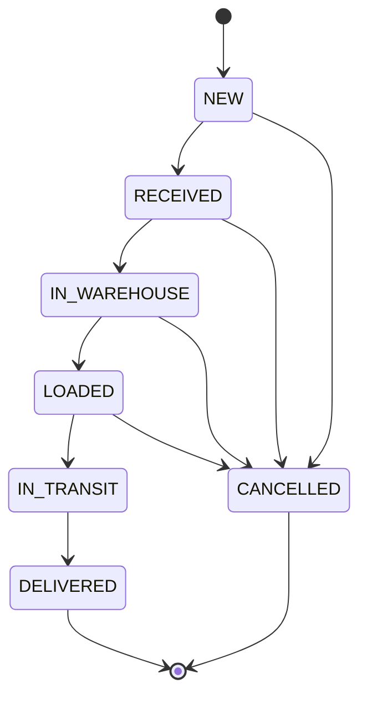

# LogiCore Backend

LogiCore is a freight and logistics operations system. It follows a shipment from the day it is booked, through receiving at the origin warehouse, storage, loading and transit, to delivery, and keeps a record of who did each step.

This repository is the REST API (Spring Boot). The web app is in a separate repository, `logicore-frontend`.

## What it covers

Freight moves between warehouses by air, ocean, ground or general freight. Along the way, operations teams need to know what is where, who is allowed to act on it, and whether anything is stopping it from moving on. LogiCore handles that:

- Each person sees only the shipments for their own region or warehouse, and only the actions that match their role.
- A shipment moves through fixed stages and cannot skip one.
- Freight that arrives damaged or short is held until a manager accepts it, with a written reason.
- A shipment that crosses a country border cannot be loaded or dispatched until customs clearance is recorded.
- Every important action is written to an audit log.
- Customers can follow a shipment with its tracking number, without logging in.

## Roles

| Role | Responsibility |
| --- | --- |
| Admin | Users, customers and the audit log. Full access. |
| Ops Manager | Shipments, customers, warehouse and dispatch. Clears receiving holds and customs. |
| Warehouse Staff | Receives freight and assigns a storage location. |
| Dispatcher | Assigns a vehicle and sends the shipment out. |
| Customer (public) | Tracks a shipment by tracking number. No login. |

A user can be limited to a region or to a single warehouse. A shipment outside their area is reported as not found.

## Shipment lifecycle



The stage rules live in one place (`ShipmentWorkflow`), and the API refuses any other move with a clear message. Before a shipment is loaded or sent, two checks apply:

- **Receiving hold:** freight received with a problem must be cleared by a manager first.
- **Customs:** if the origin and destination warehouses are in different countries, customs clearance must be recorded first.

## Features

- JWT login, four roles, and role-based access on every endpoint
- Data scoping by region or warehouse
- Shipment workflow with a strict state machine and full status history
- Optional reference number (air waybill, container or bill of lading)
- Warehouse receiving, receiving hold, and storage location (zone, rack, bin)
- Customs clearance for international shipments
- Dispatch with vehicle and destination
- Customer and user management, password change and Admin reset
- Append-only audit log, written in the same transaction as the action it records
- Server-side paging, search, filtering and sorting of shipments
- Public tracking with a timeline and rate limiting (30 requests per minute per IP)
- Login protection: 5 wrong passwords lock the account for 10 minutes

## Design decisions

- **Stateless security.** Spring Security with JWT. Passwords are hashed with BCrypt and never logged or returned.
- **Each rule in one place.** The hold and customs checks are shared services used by every path that loads or dispatches, so they cannot drift apart.
- **One error format.** A global exception handler returns every failure in the same JSON shape, with an error code.
- **No hard-coded messages.** All user-facing text is in `messages.properties`.
- **Versioned database.** Flyway migrations create the schema, and Hibernate only validates it.
- **No per-row queries on lists.** A page of shipments reads hold flags and customs status with one query each.
- **Traceable logs.** Every request gets a request id that appears in each log line.
- **Safe by default in production.** The `prod` profile has no default values, so the app refuses to start unless every secret is supplied.

## Tech stack

- Java, Spring Boot 2.7, Spring Security, Spring Data JPA (Hibernate)
- PostgreSQL 16 with Flyway (H2 in memory for tests)
- JUnit 5 and MockMvc
- Maven

## Quality

- 78 automated tests covering workflow rules, role access, scoping, holds, customs, paging, login lockout, rate limiting, customers, users, passwords, audit and error handling
- Tests run on an in-memory database, so they need no setup

## Getting started

You need Java, Maven and PostgreSQL 16.

1. Create an empty PostgreSQL database named `logicore`.
2. Set the configuration values below (local development defaults are in `application.properties`).
3. Start the app from your IDE (main class `LogiCoreOmsApplication`) or run:

```
mvn spring-boot:run
```

The API starts on http://localhost:8080. Flyway creates the tables, and on first start the app creates the first Admin account from the configuration below.

## Configuration

| Setting | Purpose |
| --- | --- |
| `LOGICORE_DB_URL`, `LOGICORE_DB_USER`, `LOGICORE_DB_PASSWORD` | Database connection |
| `LOGICORE_JWT_SECRET` | Key used to sign login tokens |
| `LOGICORE_ADMIN_EMAIL`, `LOGICORE_ADMIN_NAME`, `LOGICORE_ADMIN_PASSWORD` | First Admin account, created on first start |
| `LOGICORE_DEMO_USERS` | Creates sample staff accounts for demos (leave off in production) |

Run in production with `--spring.profiles.active=prod`. Keep real values in environment variables, never in the repository.

## API overview

| Area | Endpoints |
| --- | --- |
| Auth | `POST /api/auth/login`, `GET /api/auth/me`, `POST /api/auth/change-password` |
| Shipments | `GET` and `POST /api/shipments`, `GET /api/shipments/search` (paged), `GET`, `PUT`, `DELETE /api/shipments/{id}`, `PATCH /api/shipments/{id}/status`, `POST /api/shipments/{id}/load`, `POST /api/shipments/{id}/deliver` |
| Warehouse | `POST /api/warehouse/receive`, `POST /api/warehouse/assign-location`, `POST /api/warehouse/shipments/{id}/clear-issue` |
| Customs | `POST /api/customs/shipments/{id}/clear` |
| Dispatch | `POST /api/dispatch` |
| Customers | `GET` and `POST /api/customers`, `PUT /api/customers/{id}`, `POST /api/customers/{id}/activate`, `POST /api/customers/{id}/deactivate` |
| Users (Admin) | `GET` and `POST /api/users`, `PATCH /api/users/{id}`, `POST /api/users/{id}/reset-password` |
| Audit (Admin) | `GET /api/audit` |
| Public tracking | `GET /api/tracking/{trackingNumber}` (no login) |

## Known limitations and roadmap

- A disabled user's existing token stays valid until it expires (token revocation is planned)
- Optimistic locking for simultaneous edits is planned
- Customs status needs both warehouses chosen on the shipment
- No API docs page yet
- A hosted live demo is planned

## Author

Built by Yuvasri as a full-stack learning and portfolio project.