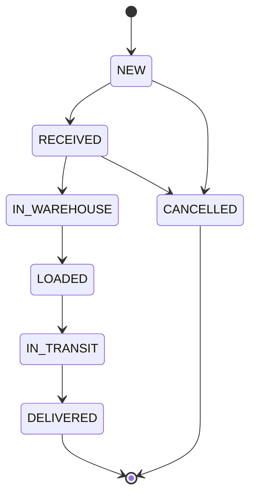

# LogiCore Backend

**LogiCore is a freight and logistics operations system. It tracks a shipment from the moment it is registered, through the warehouse and dispatch, to delivery, and records who did every step.**

This repository is the REST API (Spring Boot). The web app is in a separate repository: `logicore-frontend`.

## In plain words

Imagine a courier company. A parcel arrives, someone shelves it in the warehouse, someone loads it on a truck, and someone confirms delivery. Customers keep asking "where is my parcel?"

LogiCore handles that whole story:

- Each staff member sees only the screens that match their job.
- A shipment can only move forward in the right order. A parcel cannot be "delivered" before it is "dispatched".
- Every important action is written to an audit log, so anyone can answer "who did this, and when?"
- Customers can check their parcel with a tracking number, with no login.

## Who uses it

| Role | What they do |
| --- | --- |
| Admin | Manages users, customers and sees the audit log. Full access. |
| Ops Manager | Runs daily operations: shipments, customers, warehouse, dispatch. |
| Warehouse Staff | Receives freight and assigns a shelf location. |
| Dispatcher | Assigns a vehicle and sends the shipment out. |
| Customer (public) | Tracks a shipment by tracking number. No login needed. |

## How a shipment moves



The rules live in one place (`ShipmentWorkflow`), and the API refuses any other jump with a clear message.

## Features

- Login with JWT, four roles, and role-based access on every endpoint
- Shipment workflow with a strict state machine and full status history
- Warehouse receiving and storage location (zone, rack, bin)
- Dispatch with vehicle and destination
- Customer management (create, edit, activate, deactivate), linked to shipments
- User management for Admin (create, change role, enable, disable)
- Password change for any user, and password reset by Admin
- Append-only audit log, written in the same transaction as the action it records
- Public tracking with a timeline and rate limiting (30 requests per minute per IP)
- Login protection: 5 wrong passwords lock the account for 10 minutes

## Design decisions

- **Stateless security.** Spring Security with JWT. Passwords are hashed with BCrypt and never logged or returned.
- **One error format.** A single global exception handler turns every failure into the same JSON shape with an error code.
- **No hard-coded messages.** All user-facing text is in `messages.properties`.
- **Traceable logs.** Every request gets a request id that appears in each log line.
- **Safe by default in production.** The `prod` profile has no default values, so the app refuses to start unless every secret is supplied.

## Tech stack

- Java, Spring Boot 2.7, Spring Security, Spring Data JPA (Hibernate)
- PostgreSQL 16 (H2 in memory for tests)
- JUnit 5 and MockMvc
- Maven

## Quality

- 49 automated tests: workflow rules, role access, login lockout, rate limiting, customers, users, passwords, audit and error handling
- Tests run against an in-memory database, so they need no setup

## Getting started

You need Java, Maven and PostgreSQL 16.

1. Create an empty PostgreSQL database named `logicore`.
2. Set the configuration values below (the local development defaults are in `application.properties`).
3. Start the app from your IDE (main class `LogiCoreOmsApplication`) or run:

```
mvn spring-boot:run
```

The API starts on http://localhost:8080. On first start it creates the first Admin account from the configuration below.

## Configuration

| Setting | Purpose |
| --- | --- |
| `LOGICORE_DB_URL`, `LOGICORE_DB_USER`, `LOGICORE_DB_PASSWORD` | Database connection |
| `LOGICORE_JWT_SECRET` | Key used to sign login tokens |
| `LOGICORE_ADMIN_EMAIL`, `LOGICORE_ADMIN_NAME`, `LOGICORE_ADMIN_PASSWORD` | First Admin account, created on first start |
| `LOGICORE_DEMO_USERS` | Creates sample staff accounts for demos (leave off in production) |

Run in production with `--spring.profiles.active=prod`. Keep real values in environment variables, never in the repository.

## API overview

| Area | Endpoints |
| --- | --- |
| Auth | `POST /api/auth/login`, `GET /api/auth/me`, `POST /api/auth/change-password` |
| Shipments | `GET` and `POST /api/shipments`, `GET`, `PUT`, `DELETE /api/shipments/{id}`, `PATCH /api/shipments/{id}/status`, `POST /api/shipments/{id}/load`, `POST /api/shipments/{id}/deliver` |
| Warehouse | `POST /api/warehouse/receive`, `POST /api/warehouse/assign-location` |
| Dispatch | `POST /api/dispatch` |
| Customers | `GET` and `POST /api/customers`, `PUT /api/customers/{id}`, `POST /api/customers/{id}/activate`, `POST /api/customers/{id}/deactivate` |
| Users (Admin) | `GET` and `POST /api/users`, `PATCH /api/users/{id}`, `POST /api/users/{id}/reset-password` |
| Audit (Admin) | `GET /api/audit` |
| Public tracking | `GET /api/tracking/{trackingNumber}` (no login) |

## Project structure

```
src/main/java/com/devbridge/logicore
  config/       security rules, startup data, validation
  controller/   REST endpoints
  service/      business logic (workflow, audit, passwords)
  security/     JWT, rate limiting, login lockout
  model/        database entities
  enums/        roles, statuses, error codes
  exception/    one global error handler
src/main/resources/messages.properties   all user-facing text
```

## Known limitations and roadmap

- A disabled user's existing token stays valid until it expires (token revocation is planned)
- Shipment lists are not paged yet
- Database changes use Hibernate auto-update; Flyway migrations are planned
- Optimistic locking for simultaneous edits is planned
- A hosted live demo is planned

## Author

Built by Yuvasri as a full-stack learning and showcase project.